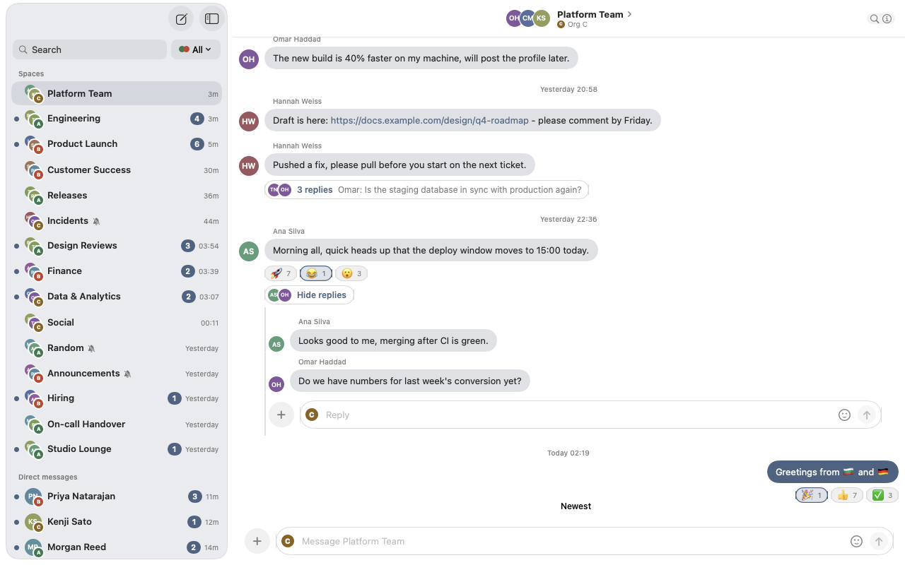
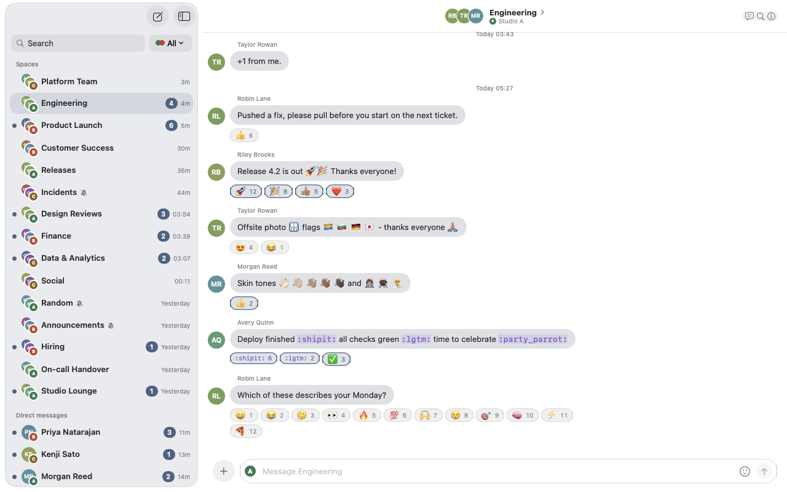
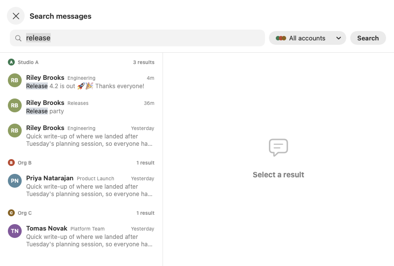

# Thimble

Thimble is a native Mac app for Google Chat™. Keep several Google Workspace accounts in one inbox, reply in threads,
share attachments, and search message history. Each conversation shows which account you’re sending from.

<picture>
  <source media="(prefers-color-scheme: dark)" srcset="docs/screenshots/threads-dark.png">
  
</picture>

<table>
  <tr>
    <td></td>
    <td></td>
  </tr>
</table>

Screenshots use the built-in sample data (<code>make fake</code>); every person and organization in them is made up.

## Getting started

- **Try it with sample conversations.** Build the app on macOS 27 or later and launch sample mode. You can explore the inbox before connecting a Google account. [Build and try the app](docs/user-guide.md#build-and-try-the-app)
- **Connect your Workspace.** Someone in your organization sets up a Google Cloud project once and shares a Desktop OAuth client file with the people using the app. [Set up Google Cloud](docs/user-guide.md#set-up-google-cloud)
- **Already have the client file?** Open the app, choose the file, and sign in with your Workspace account. [Sign in on your Mac](docs/user-guide.md#sign-in-on-your-mac)

**⌘K** switches conversations. **⌘F** searches one or all accounts, including older messages. Reading replies in
the active thread syncs your read position to Google Chat. **Settings → Accounts → …** lets you reconnect or remove an account.

## Acknowledgments

Thank you to **Kim Nørgaard, Netic A/S, and the contributors to mutter**, the Go terminal client for Google Chat.
Their work showed how a user-authenticated client can handle threads, read state, reactions, and Workspace setup.
We used it as an API reference when building this Swift client. [mutter on GitHub](https://github.com/neticdk/mutter) · [Reference revision](https://github.com/neticdk/mutter/tree/04ff31c142b3c3436bb8f47b4155f58f17e53b31) · [mutter’s MIT license](https://github.com/neticdk/mutter/blob/04ff31c142b3c3436bb8f47b4155f58f17e53b31/LICENSE)

## License

Thimble is available under the [MIT License](LICENSE).

## Trademarks

Thimble is an independent project. It is not affiliated with or endorsed by Google. Google Chat and Google Workspace
are trademarks of Google LLC.
